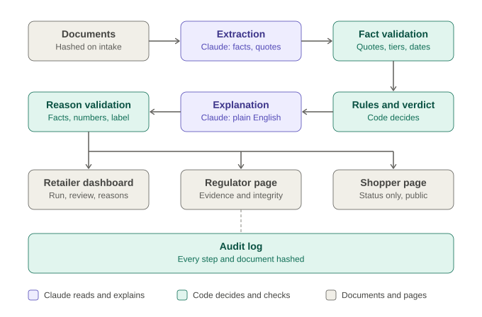

# Product-Level Sustainability Claim Verifier

A Claude-powered evidence engine that traces a retailer's sustainability claim through every supplier tier to the source documents, issues an honest verdict, and shows two views: a short public page for shoppers and a login-protected evidence trail for regulators.

> All supplier names, documents and certificates in this repository are **synthetic**. No real companies or data are used.

## The problem

Retailers make claims about origin, packaging and carbon footprint, but they cannot prove them at product level. The evidence sits with suppliers at several tiers (garment makers, mills, farms, resin producers) as certificates, invoices, spreadsheets and emails. It is rarely linked to the product on the shelf, so a claim made at the top of the chain is not checked against the documents at the bottom. That exposes retailers to regulatory and reputational risk, leaves regulators with marketing statements instead of evidence, and asks shoppers to trust labels nobody can verify.

## The approach

**Claude reads and explains. Code decides and checks. Nothing is accepted that code cannot verify.**



*Purple boxes are Claude, teal boxes are code, grey boxes are documents and pages. Every step is recorded in the hash-chained audit log.*

| Step | Who does it | What code checks |
|---|---|---|
| Read each document into facts | Claude | Every `source_quote` must appear in the document; supplier and tier must match the registered supply chain; dates and percentages must be valid. Anything else is rejected and listed, never dropped silently |
| Decide the verdict | Code | Rules run per claim type. Verdicts: Verified, Self-declared only, Contradicted, Missing evidence |
| Explain the verdict | Claude | The explanation is accepted only if every cited fact exists, every number, date and country appears in the input, quoted text is real, and the label is not contradicted. Otherwise the template reason is used and the fallback is recorded |
| Record everything | Code | Append-only, SHA-256 hash-chained audit log, plus a hash of every source document |

Design principles: Claude never invents evidence, "no evidence found" is a valid result, code does the rules and all math, and uncertain items go to a person.

## What it does today

- Four demo products with different outcomes:
  - **Cotton T-shirt** ("Organic cotton from India"): **Contradicted**. A tier-3 invoice states Bangladesh as the origin, and the organic certificate expired before the shipment.
  - **Bottled water** ("100% recycled bottle"): **Contradicted**. The packaging spec and the certificate say 60%, and the tier-3 resin supplier has no documents.
  - **Second bottle** ("Eco-friendly packaging"): **Self-declared only**. The wording is vague and unprovable.
  - **Organic poplin shirt** ("Organic cotton from India"): **Verified**. The declaration and the tier-3 invoice both state India, and a valid organic certificate backs the mill. It is a clean control: change the invoice to another country and the verdict becomes Contradicted.
- **Retailer dashboard** with a Run verification button, verdict badges, reasons, checks and a supplier tree coloured by evidence status.
- **Public shopper page** at `/p/{product_id}`: mobile-first, fixed wording per status, no supplier names, file names or hashes.
- **Regulator page** at `/regulator/{product_id}`: verdict, checks, facts with source quotes (the contradicting quote is highlighted), document hashes, the full history, and a **Verify integrity** button that recomputes the hash chain and re-hashes the documents.
- **Real Claude extraction** (structured outputs, model `claude-sonnet-5-5`) with a disk cache, and **Claude-written explanations** validated by code. The history records which model produced each entry's content (and says "not applicable" where no model was involved), whether a result was cached, and which reason source was used.
- 301 automated tests (see below), including leak tests for the public page, that never need a key or the network.

## Quick start (mock mode, no API key)

Requires Python 3.11 or newer.

```powershell
python -m venv venv
venv\Scripts\activate          # macOS/Linux: source venv/bin/activate
pip install -r requirements.txt
uvicorn backend.main:app
```

Open `http://127.0.0.1:8000/`, then:

1. Go to `/dashboard` and sign in as the demo retailer (accounts are listed in `SETUP.md`).
2. Click **Run verification** on each product.
3. Open the shopper page and the regulator page for any product.

In mock mode, extraction comes from prepared files in `data/mock_extractions/` (checked against the documents), and verdict reasons come from a template. The pipeline, rules, audit log and pages are the same as in real mode.

## Real Claude mode

1. Create a `.env` file in the project root containing `ANTHROPIC_API_KEY=your-key` (the file is git-ignored; never commit it).
2. Set real mode for the terminal only: `$env:MOCK_MODE="false"`
3. Optional, for always-live calls: `$env:EXTRACTION_CACHE="off"` and `$env:REASON_CACHE="off"`
4. Start the server and run the products. Real runs spend API credits, so set a spending limit in the Anthropic console.

To compare Claude's extraction with the prepared files: `python scripts/compare_extraction.py`. To compare template and Claude explanations: `python scripts/compare_reasons.py`.

## Tests

```powershell
python -m pytest -q
```

The suite passes with no API key and no network. A fixture blocks any real API client in non-live tests. The live tests are skipped unless both `ANTHROPIC_API_KEY` and `RUN_LIVE_EXTRACTION=1` are set.

## Project layout

```
backend/    extract, rules, verdict, reason, audit, pipeline, retailer, main (FastAPI)
frontend/   index, dashboard, shopper, regulator (single-file HTML, no external scripts)
data/       products.json, documents/, mock_extractions/, answer_key.json
scripts/    compare_extraction.py, compare_reasons.py
docs/       architecture.svg
tests/      unit, API, page and leak tests
SPEC.md     full specification      CLAUDE.md   project rules      SETUP.md   setup and deployment notes
```

## Honest limits

- **Synthetic data only**, and clean text documents. PDFs, scans and spreadsheets are not yet supported.
- **Demo logins** stand in for a real identity provider and are not security.
- **The audit log is tamper-evident, not tamper-proof.** It detects edits, deletions in the middle, reordering and changed documents. It does not detect truncation of the last entries or a full rewrite of the chain by someone with write access, which would need an external anchor. It is a hash chain, not a blockchain.
- **It does not detect forged certificates.** Checking certificate IDs against certifier registries is on the roadmap.
- **"Verified" is narrow.** It means a certificate ID is present, every check passed and no document contradicts the claim. The certifier's independence and the certificate's genuineness are not checked.
- **Claim scope is not checked.** A claim about the cotton does not say whether the whole product is covered, for example a cotton and linen blend.
- **Carbon footprint claims are not built yet.** The design is that code does all the arithmetic from labelled emission factors, and Claude only selects the factor and explains it.
- **Fact IDs differ between mock and real mode**, so answer-key matching by file and field is planned.
- The shopper page supports, but does not replace, the claims printed on pack. A contradicted claim should not be printed.
- Uploaded or edited documents are sent to the Claude API in real mode. Treat that as a data-sharing decision before using real supplier data.

## Roadmap

Live document upload, a Claude cross-check that flags findings no rule covers (advisory, validated by code), supplier email drafts, PDF and spreadsheet support, the carbon calculator, a review queue, QR codes on packaging pointing to the stable shopper URL, batch-level evidence, a claim-scope check, certifier registry checks, an external hash anchor, and a real identity provider.
